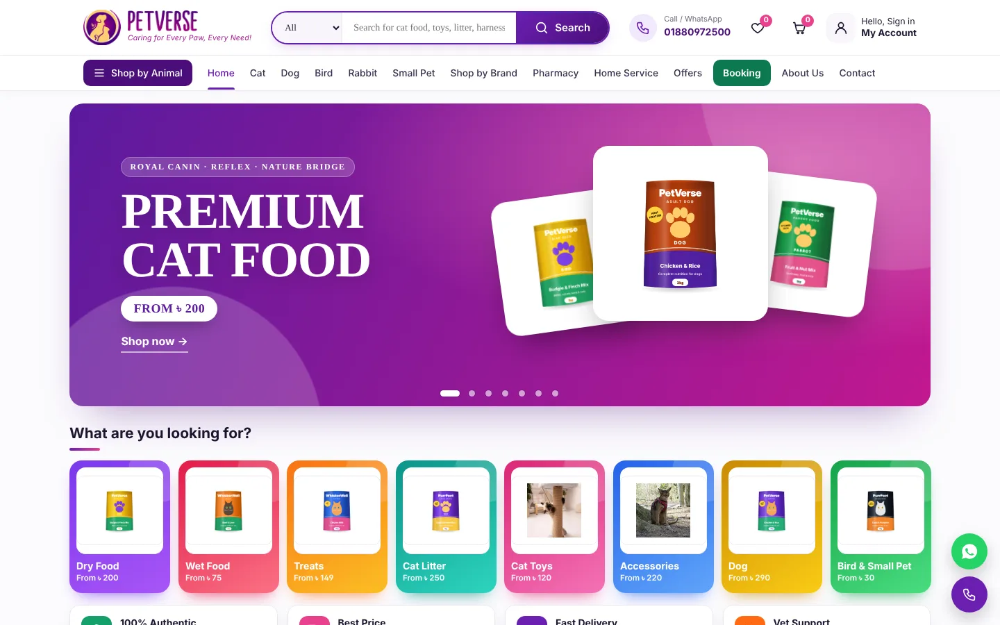
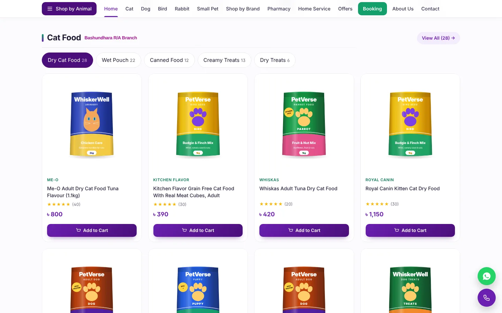
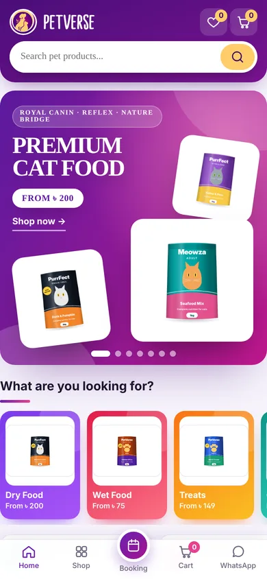
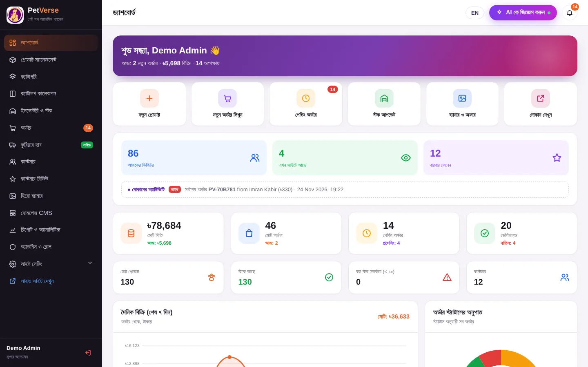
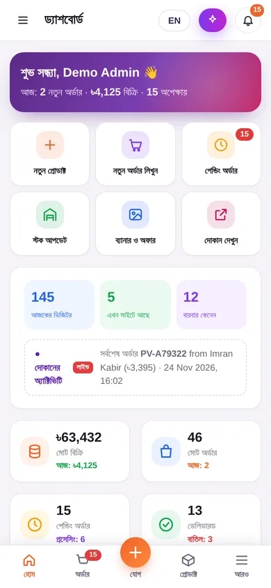

<p align="center">
  
</p>

<h1 align="center">PetVerse: Online Pet Shop</h1>

<p align="center">
  <b>Caring for Every Paw, Every Need.</b><br>
  A fast, phone-first pet shop for Bangladesh, with a full admin panel in Bangla.
</p>

<p align="center">
  <a href="https://abid2929.github.io/Petverse/"></a>
  <a href="https://abid2929.github.io/Petverse/admin/"></a>
  
</p>

<p align="center">
  
</p>

---

## Live links

| | |
|---|---|
| 🛍️ **Shop** | https://abid2929.github.io/Petverse/ |
| 🔧 **Admin (demo)** | https://abid2929.github.io/Petverse/admin/ |
| 📞 **Call / WhatsApp** | 01880972500 (Bashundhara R/A branch) |

> On GitHub Pages there is no server, so checkout sends the order on WhatsApp and the admin runs as a **demo** (no password; changes stay only in your own browser). Product and price changes for everyone are made in the `data/` files of this repo.

## Screenshots

<table>
  <tr>
    <td width="68%"></td>
    <td></td>
  </tr>
  <tr>
    <td></td>
    <td></td>
  </tr>
</table>

<sub>Some product photos in these screenshots are samples. The live site shows each product's real photo.</sub>

## Features

**Storefront (English)**
- Bold auto-sliding product banners and a colourful “What are you looking for?” category row right at the top
- Smooth entrance animation, app-style phone layout with bottom tab bar
- Cat Food by type (Dry, Wet Pouch, Canned, Creamy Treats, Dry Treats), Litter, Toys, Accessories, Dog, Bird & Small Pets, Shop by Brand
- Quick view with gallery, sizes and colours · cart · wishlist · search
- Checkout with delivery charge (inside / outside Dhaka), Cash on Delivery, bKash / Nagad with TrxID, and **Track Order**
- Vet services, home service and appointment booking on WhatsApp

**Admin panel (Bangla, with EN switch)**
- Dashboard: greeting, today's orders and sales, one-tap actions, visitors, live activity, 7-day sales chart
- Orders with invoice print and CSV export · manual orders (phone / Facebook) · Steadfast courier hub
- Products: sizes, colours, multi-image gallery, AI description writer, New / Best Seller / Flash Sale tags, stock
- Categories, collections, inventory, customer reviews, hero banners, homepage text
- Admins and roles (super admin, manager, staff) · password eye button · forgot-login reset
- Settings: store info, delivery, payment, courier, SMS, Facebook Pixel + Conversions API, Google SEO

**Speed & SEO**
- Google Lighthouse: SEO 100, desktop performance 98
- Sitemap, robots.txt, share image, structured data

## Tech

Plain **HTML + CSS + JavaScript** storefront and a **PHP** admin/API with JSON file storage. No database or build step needed. Runs on GitHub Pages (demo mode) or any cPanel hosting with PHP 8 (full mode).

```
index.html        storefront
admin/            admin panel (admin.js, admin2.js, bn.js Bangla layer)
data/*.json       products, categories, banners, reviews, site settings
shop-api.php      orders, order tracking, reviews (server mode)
inc/store.php     storage helpers
```

## Setup on cPanel (full mode)

1. Upload the files to `public_html` (or upload the zip and **Extract**). Keep the hidden `.htaccess` files.
2. Open `yourdomain.com/admin` and create the main admin username and password.
3. Fill in **Site settings** (phone, delivery, payment), then add or edit products and press **Save**.
4. Forgot the login? Upload an empty file named `reset-admin.txt` to `public_html`, then open `/admin` and create a new one.

---

<p align="center"><sub>Designed &amp; developed by Abid Islam &amp; <a href="https://www.boostnixmedia.com">Boostnix Media</a></sub></p>
